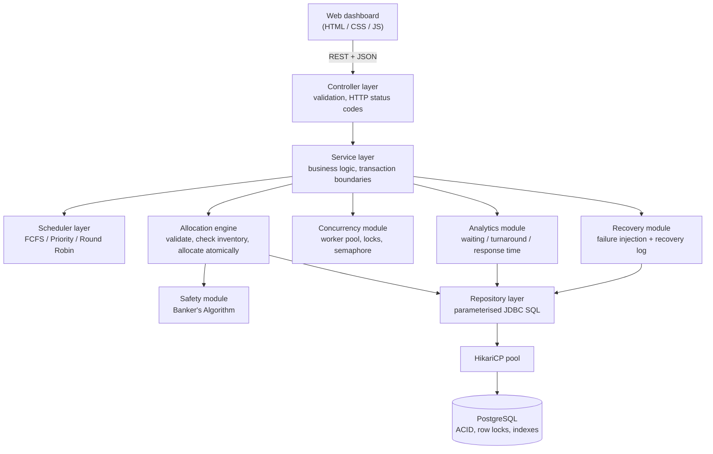
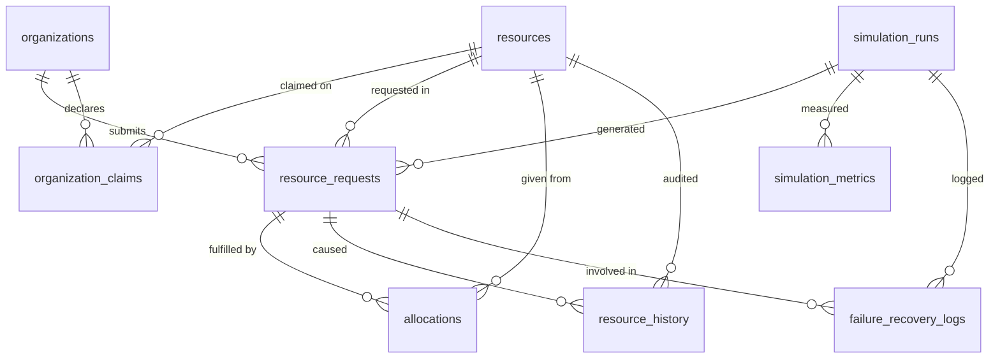

# Architecture, Database Design and Phase Plan

> Academic simulator. Not connected to real emergency services; it makes no real dispatch decisions.

## 1. Architecture



**Separation of responsibilities.** The scheduler only decides *order*. The allocation engine only decides
*whether a unit can be given*. The safety module only answers *is the resulting state safe*.
A scheduler can never override a resource constraint or a safety check.

## 2. Directory structure

```
disaster-resource-allocation/
├── pom.xml                      Maven build (Spring Boot 3.3, Java 21)
├── README.md
├── .env.example                 environment variable template (no real secrets)
├── db/migrations/               V1__schema.sql, V2__seed.sql
├── scripts/setup-db.sh          creates role + database, applies migrations (idempotent)
├── docs/ARCHITECTURE.md         this file
└── src/
    ├── main/java/com/disaster/allocation/
    │   ├── controller/          REST endpoints
    │   ├── service/             business logic, @Transactional boundaries
    │   ├── scheduler/           SchedulingAlgorithm interface + 3 implementations
    │   ├── allocation/          allocation engine
    │   ├── safety/              Banker's Algorithm
    │   ├── concurrency/         worker pool, locks, semaphore
    │   ├── repository/          SQL (JdbcTemplate)
    │   ├── analytics/           metric formulas
    │   ├── recovery/            failure injection, recovery logging
    │   ├── model/               plain data classes
    │   └── config/
    ├── main/resources/          application.properties, static/ (dashboard)
    └── test/java/...            JUnit 5 tests
```

## 3. Database design



| Table | Purpose |
|---|---|
| `organizations` | hospitals, shelters, rescue teams (active flag) |
| `resources` | inventory; **CHECK (total = available + allocated)** enforced by the database |
| `organization_claims` | declared maximum per (organization, resource) = Banker's **Max** matrix |
| `resource_requests` | one request; priority 1-5, `arrival_seq` for deterministic FCFS order, status, timestamps |
| `allocations` | one row per allocation event (ACTIVE / RELEASED) |
| `resource_history` | append-only audit trail of every change in availability |
| `simulation_runs` / `simulation_metrics` | one row per run (algorithm, quantum, seed, size, duration) and its measurements |
| `failure_recovery_logs` | injected failures, rollbacks, recoveries; written in a separate transaction so it survives the rollback it describes |

### Indexes (each tied to a query the application runs)

| Index | Query it serves |
|---|---|
| `idx_requests_queue` (partial: PENDING/WAITING/PARTIALLY_ALLOCATED, `priority DESC, arrival_seq`) | next requests to schedule |
| `idx_requests_resource_status` | requests per resource and status |
| `idx_requests_org` | an organization's requests (Banker's allocation matrix) |
| `idx_requests_run` (partial) | requests of one simulation run |
| `idx_alloc_request`, `idx_alloc_resource_active` (partial) | allocation matrix, active allocations |
| `idx_history_resource_time` | history of one resource, newest first |
| `idx_failure_run` | recovery log per run |

The planner was confirmed to pick `idx_requests_queue` for the queue query on a tiny table. **No performance
benefit is claimed** until it is measured on generated workloads (Phase 8).

## 4. Modelling decisions

1. **Processes and resources.** A request is the "process" being scheduled; resources are the limited inventory.
2. **Banker's Algorithm.** Processes in the matrix are *organizations*; `Max` comes from `organization_claims`;
   `Allocation` is derived from ACTIVE allocations; `Need = Max - Allocation`.
3. **Reusable vs consumable.** Ambulances, beds, staff are `reusable` (units return) so the classic model applies.
   Food, water, medicine are consumable stock: they only get a normal inventory check, not a deadlock-avoidance
   check, because consumed stock never comes back and so does not form a classic circular wait.
4. **Round Robin and the time quantum.** Allocation requests are not CPU bursts, so each request carries
   `work_units` of *simulated* processing time. Under Round Robin every eligible request receives at most
   `quantum` work units per turn, then goes to the back of the queue. (Implemented and documented in Phase 3.)
5. **Priority ties** are broken by `arrival_seq` (earlier first), so results are deterministic.
6. **Metrics.** Response = first processing - arrival. Turnaround = completion - arrival. Waiting = turnaround -
   service time. Uncompleted requests are reported separately, never folded into averages.
7. **Concurrency layers are separate.** Java locks/semaphore protect in-memory state; PostgreSQL row locks
   (`SELECT ... FOR UPDATE`) and transactions protect stored data. The database stays safe even if Java-side
   locking were removed.

## 5. Phase plan

| Phase | Scope | Status |
|---|---|---|
| 1 | Project structure, schema, seed data, setup script | done, applied to PostgreSQL 16 earlier |
| 2 | Resource + organization management (REST + JDBC) | code written; integration-tested only once run against PostgreSQL |
| 3 | Request management + FCFS / Priority / Round Robin on the real queue | schedulers tested; REST/persistence written |
| 4 | Allocation engine + Banker's integration (`allocation/`) | written; pure parts unit-tested, DB parts need a run |
| 5 | Row-level locking and concurrency | `SELECT ... FOR UPDATE` implemented; `ConcurrencyIT` written, not yet run |
| 6 | Rollback and failure injection | implemented; `RollbackIT` written, not yet run |
| 7 | Dashboard | written (`static/`); syntax-checked only |
| 8 | Workload generator, index benchmarks | not done |

Not implemented from the original diagram: the `concurrency/` worker pool / semaphore package and a separate
`recovery/` package (rollback logging lives in `SchedulingService` and `SimulationRepository`).

## 6. Authentication and tenant boundaries (DRAS 2.0)

### Authentication flow

* `POST /api/auth/register` creates a pending user and approval request for any of the four roles. Members must select
  an active organization; managers submit a proposed organization name and receive possible-name-match feedback. A
  manager application has no organization membership until an administrator approves it. Privileged selections create
  pending global-role requests only; public registration never assigns a global role.
* `POST /api/auth/login` verifies BCrypt credentials and rejects pending, disabled, or inactive-organization
  accounts. It returns a short-lived JWT and sets an HttpOnly refresh cookie. `POST /api/auth/refresh` rotates the
  stored refresh-token hash and rejects reuse; logout revokes the cookie token.
* JWT claims include the account ID, roles, organization ID (when applicable), and token version. Each request
  validates the signature, account status, membership/org status, and token version against PostgreSQL.
* On normal startup, the one-time database-locked provisioner creates missing `admin@dras.local` and
  `dispatcher@dras.local` accounts with distinct random temporary passwords. Only BCrypt hashes are stored in PostgreSQL;
  the local-only credential file is `~/.config/dras/initial-accounts.txt` (mode 600). Both accounts must change their
  passwords before accessing other API routes. Test profiles do not run the provisioner.

### Authorization boundaries

| Role | Server-enforced scope |
|---|---|
| `SYSTEM_ADMIN` | Global administration, approvals, user roles, audit history, organization/resource management, diagnostics |
| `DISPATCHER` | Global operational queue, allocation, scheduling, alerts, and minimized organization summaries; no user/approval administration |
| `ORGANIZATION_MANAGER` | Own organization, claims/profile, organization requests/allocations/metrics, and own membership administration |
| `ORGANIZATION_MEMBER` | Own organization summary, resource availability, own requests; no claim/member/admin operations |

Controllers use `AccessControl` for operation checks and query services/repositories scope rows by trusted JWT
organization and user IDs. Tenant request submission overrides any client-supplied organization ID. Public
organization discovery is a separate minimal DTO endpoint and does not make organization management APIs public.

### Additive authentication schema

V3 introduces users, organization memberships, approval requests, hashed refresh tokens, audit logs, alerts, and
acknowledgements. V4 adds request ownership and actual request lifecycle events. V5 extends approval requests for
manager applications, possible organization matches, and administrator-selected approval association. All are
additive migrations; V1/V2 are retained. Existing rows are preserved and approved-request rows are backfilled from
their existing membership during V5.

`test` is the permissive test profile for legacy API tests. Auth integration tests additionally activate
`auth-test`, which excludes the legacy test filter chain and activates production `SecurityConfig` and production
`AccessControl` behavior. The PostgreSQL-backed tests create uniquely named test rows and clean only those rows.
